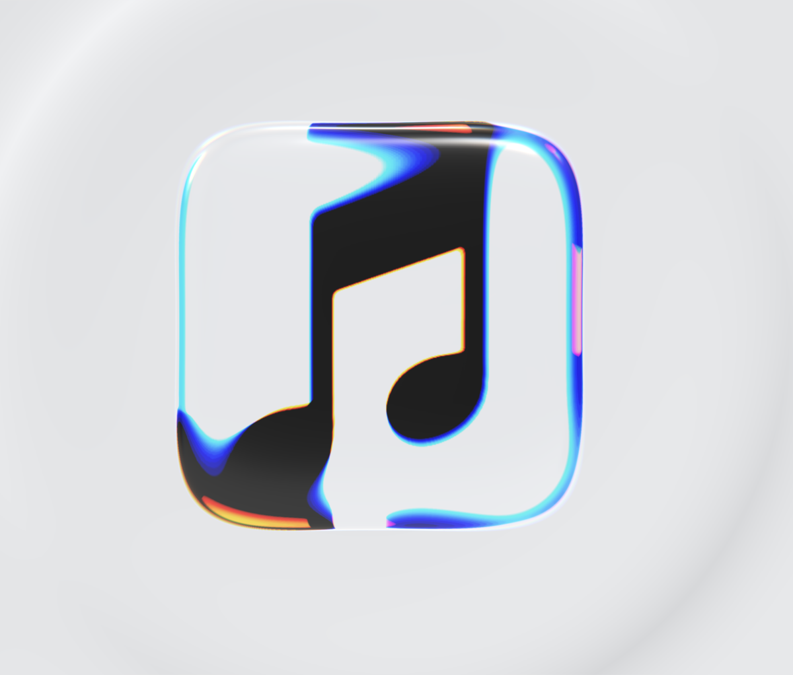

# icon-reveal-webgpu

Glass-block icon reveal with spectral refraction and a ripple wave, in three.js WebGPU + TSL.



**Demo:** https://felixturner.github.io/icon-reveal-webgpu/

Requires a WebGPU browser (Chrome / Edge 113+, Safari 26+).

## How it works

The icon sits on a flat unlit plane under a real 3D glass block, built as a superellipsoid in the vertex shader so GSAP can morph it from a growing circle into a squircle and flatten it out. The block uses `MeshPhysicalNodeMaterial` for reflections plus a custom TSL refraction node that bends the view ray 16 times at slightly different IORs, blended through a rainbow palette for smooth dispersion. A post pass adds a travelling sine ripple that refracts the whole frame.

Notes and references: [docs/notes.md](docs/notes.md)

## Run

```bash
npm install
npm run dev
```

Click Play (or press space to pause). The GUI button shows the controls.
